# Beach Bistro WordPress

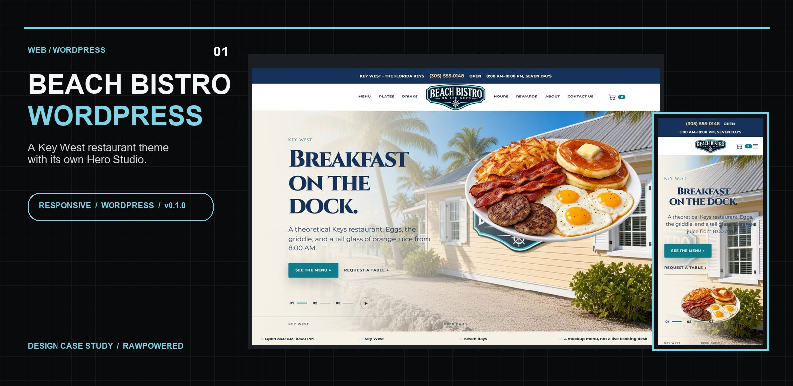

<strong>KEY WEST &nbsp; / &nbsp; WORDPRESS &nbsp; / &nbsp; VERSION 0.1.0</strong>

  <a href="https://rawpowered.github.io/BeachBistro-WordPress-Showcase-Public/"><strong>Case study</strong></a> &nbsp; · &nbsp;
  <a href="docs/previews/desktop.jpg"><strong>Desktop capture</strong></a> &nbsp; · &nbsp;
  <a href="docs/previews/mobile.jpg"><strong>Mobile capture</strong></a> &nbsp; · &nbsp;
  <a href="https://github.com/RawPowered"><strong>Contact</strong></a>

A Key West restaurant WordPress theme by <strong>Joseph Edwards (RawPowered)</strong>. Its bundled Hero Studio gives site owners direct control over the homepage's slides, scene, plate, copy, design, and motion. The restaurant, phone, and address are fictional.

<table>
  <tr>
    <td width="33%" align="center"><strong>Bundled Hero Studio</strong> No separate slider plugin needed for the theme homepage</td>
    <td width="33%" align="center"><strong>Menu, hours, and a table request</strong> Meal filters, dock hours, and a preview-only reservation form</td>
    <td width="33%" align="center"><strong>Theme-wide controls</strong> Fonts, colors, logos, header, contact, map, and a homepage cache</td>
  </tr>
</table>

  <a href="performance/2026-11-01/README.md">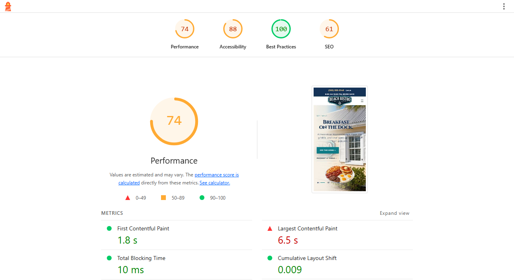</a>
  <a href="performance/2026-11-01/README.md">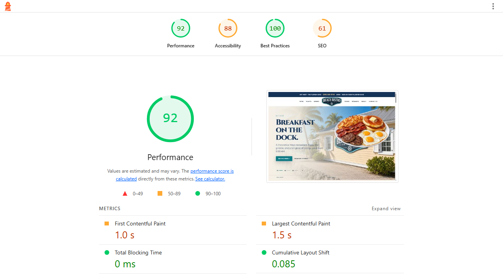</a>

<strong>74 mobile performance · 92 desktop performance · captured November 1, 2026</strong>

<small>Namecheap’s smallest shared plan, on a subdomain. Cloudflare and a CDN were not used. The result depends on the host. The homepage speed pass is automatic: WebP art, layout CSS in the HTML, deferred scripts, and a guest cache.</small>

## See the site in motion

<a href="docs/previews/desktop.jpg">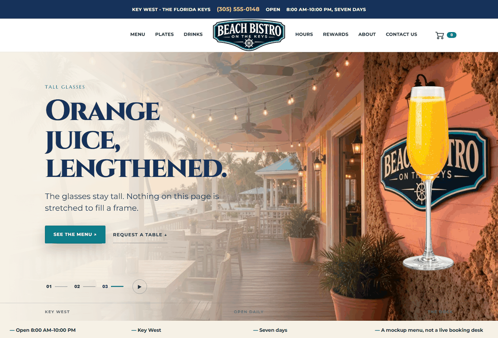</a>

<small>Animated from the November 1, 2026 WordPress lab capture. Click to open the full-page still. The lab URL stays internal.</small>

## Explore the experience

<table>
  <tr>
    <td width="66%" align="center"><a href="docs/previews/desktop.jpg">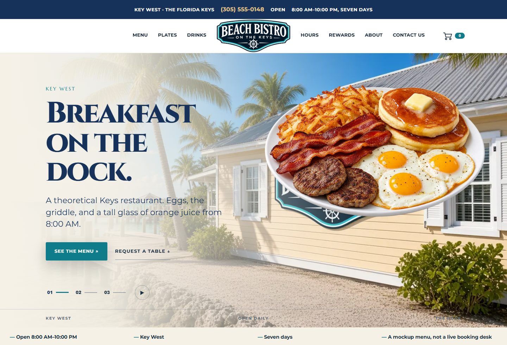</a> <strong>Desktop</strong> · <a href="docs/previews/desktop.jpg">Full-page capture</a></td>
    <td width="34%" align="center"><a href="docs/previews/mobile.jpg">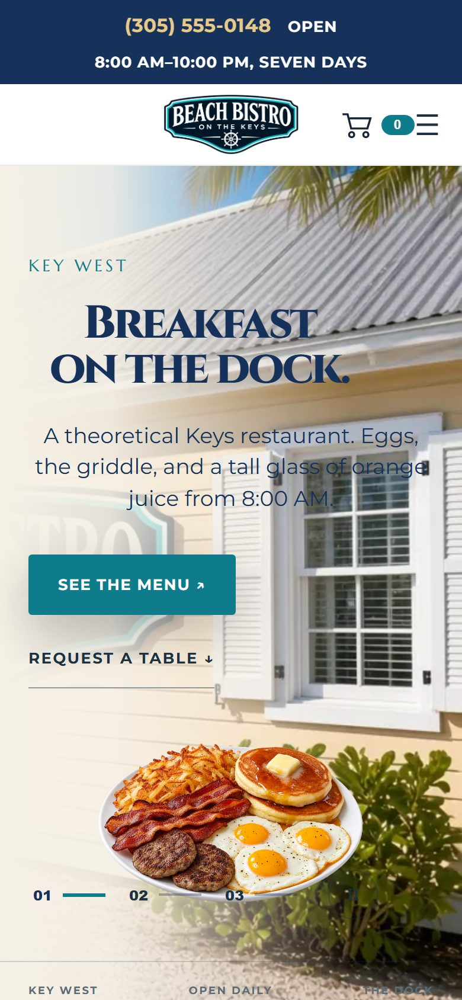</a> <strong>Mobile</strong> · <a href="docs/previews/mobile.jpg">Full-page capture</a></td>
  </tr>
</table>

| Preview | What it shows |
| --- | --- |
| [Desktop homepage](docs/previews/desktop.jpg) | Call bar, hero plate, table request, menu, hours, and labeled sample notes |
| [Mobile homepage](docs/previews/mobile.jpg) | The same page on a narrow screen |
| [Menu](docs/previews/menu.jpg) | The menu page |
| [Rewards](docs/previews/rewards.jpg) | The rewards signup page |
| [About Us](docs/previews/about.jpg) | The dock story and editorial page layout |
| [Contact Us](docs/previews/contact.jpg) | Table request with the month and time picker |

<table>
  <tr><td width="50%" align="center"><a href="docs/previews/about.jpg">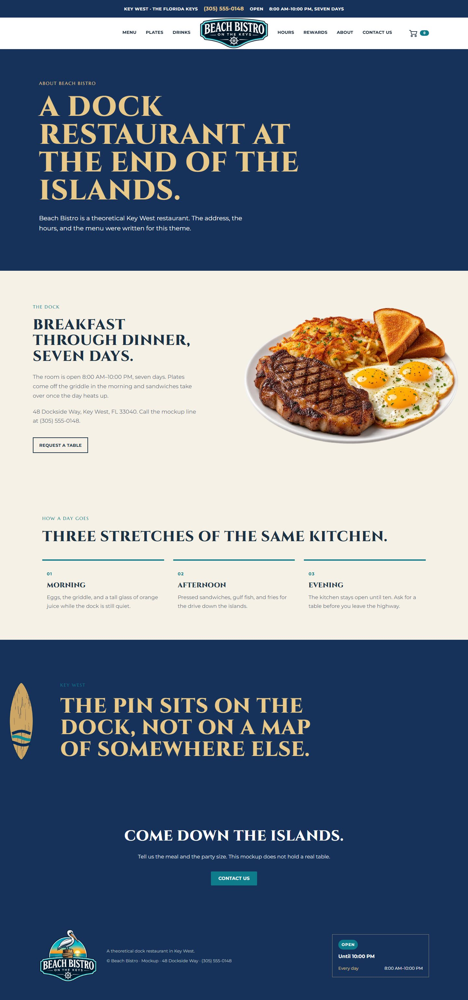</a> <strong>About Us</strong></td><td width="50%" align="center"><a href="docs/previews/contact.jpg">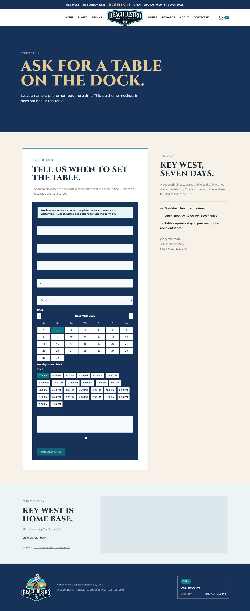</a> <strong>Contact Us</strong></td></tr>
</table>

<strong>View footer map options</strong>

<a href="docs/previews/footer-no-map.jpg">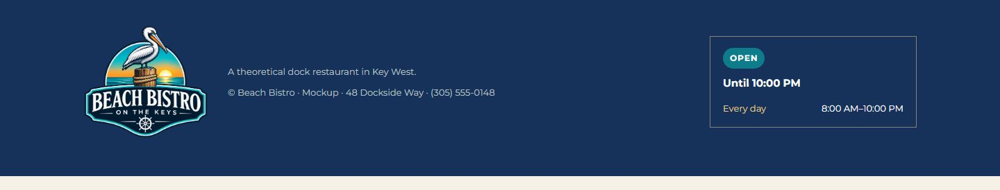</a> <a href="docs/previews/footer-with-map.jpg">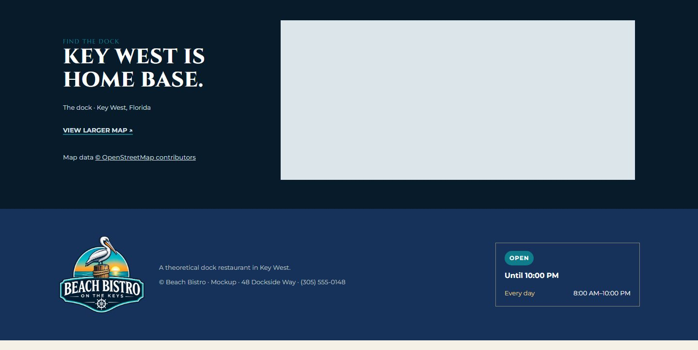</a>

The captures above are from the WordPress theme on the lab, not a copied layout. The charcoal and glass framing belongs to this RawPowered case study. The restaurant site has its own navy, tide, sand, and cream identity. Homepage notes are sample copy for the mockup. They are not live reviews.

## Hero Studio

<a href="docs/previews/admin/hero-studio-canvas.jpg">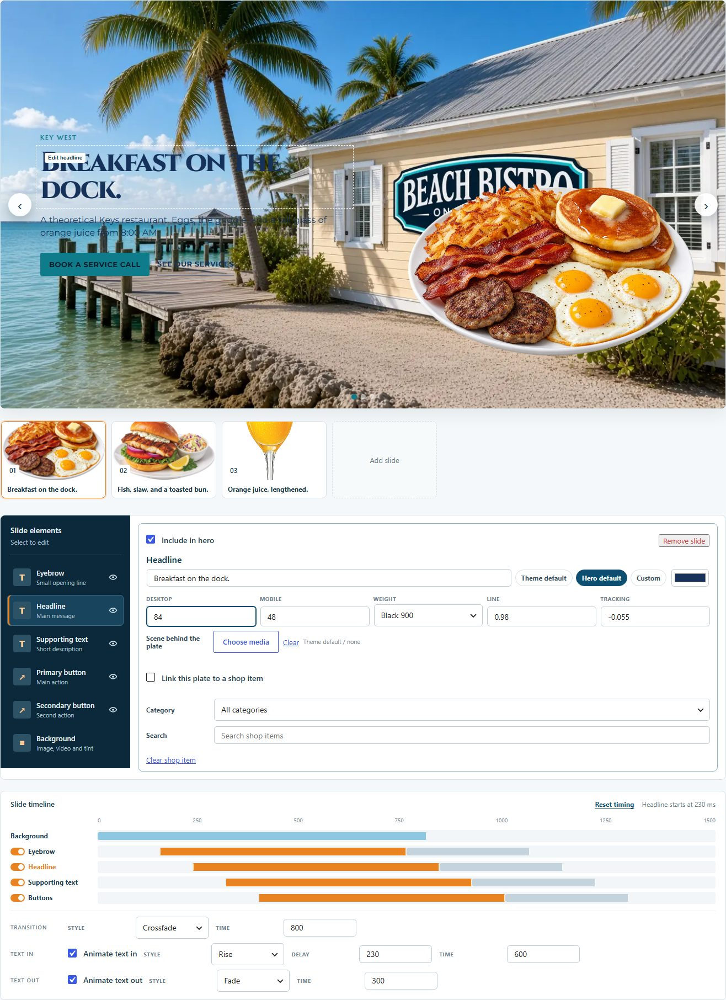</a>

<small>Actual Hero Studio in the local WordPress theme lab, captured November 1, 2026.</small>

### A built-in visual editor for the most visible part of the site

**Appearance → Hero Studio** manages the theme's bundled homepage hero. Site owners can build an image or video slideshow with a scene behind a plate, tailored copy, and calls to action, then see the result before publishing. These controls ship with Beach Bistro. The bundled homepage does not need a separately purchased slider or an additional slider plugin to use them.

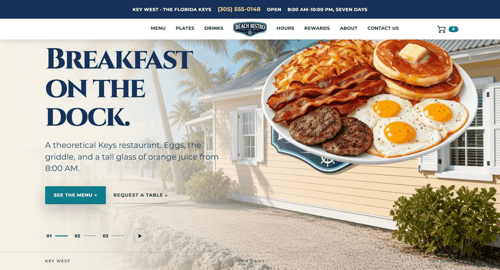

<small>Three actual WordPress slide captures assembled with crossfades for README playback. This is not a continuous screen recording.</small>

<table>
  <tr>
    <td width="33%" align="center"><a href="docs/previews/admin/live-slide-1.jpg">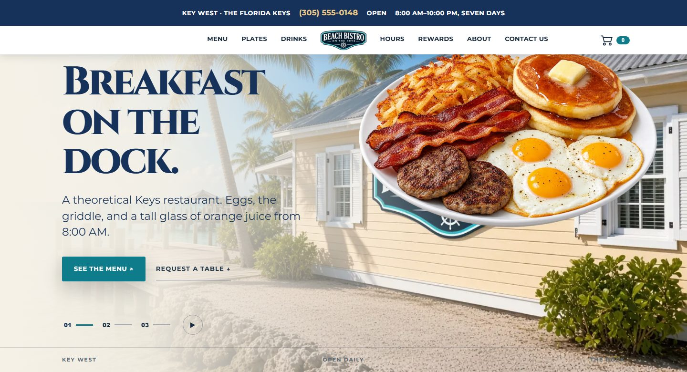</a> <strong>01 / Breakfast on the dock</strong></td>
    <td width="33%" align="center"><a href="docs/previews/admin/live-slide-2.jpg">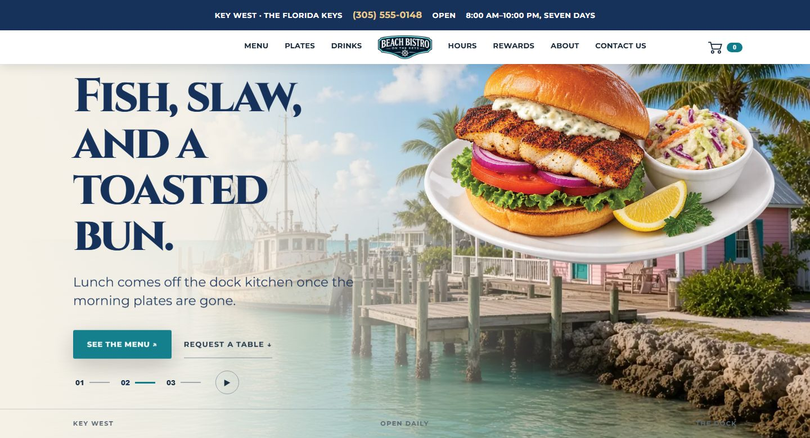</a> <strong>02 / The next plate</strong></td>
    <td width="33%" align="center"><a href="docs/previews/admin/live-slide-3.jpg">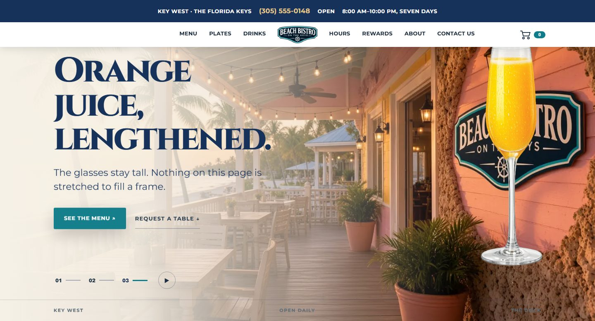</a> <strong>03 / A tall glass</strong></td>
  </tr>
</table>

<table>
  <tr>
    <td width="33%" align="center"><strong>Build the story</strong> Up to eight slide slots, with three enabled in the starter setup</td>
    <td width="33%" align="center"><strong>Shape the look</strong> Scene, plate, overlays, typography, layout, and two buttons per slide</td>
    <td width="33%" align="center"><strong>Direct the motion</strong> Transitions, layer timing, autoplay, and playback controls</td>
  </tr>
</table>

The workspace keeps the slide list, live canvas, selected element controls, and motion timeline together. Click a layer to edit it; hide a layer without deleting its copy. Desktop and mobile views update as settings change, and full-screen preview plays the draft slideshow before it is saved.

### Inside the editor

<table>
  <tr>
    <td width="50%" align="center"><a href="docs/previews/admin/hero-studio-inspector.jpg">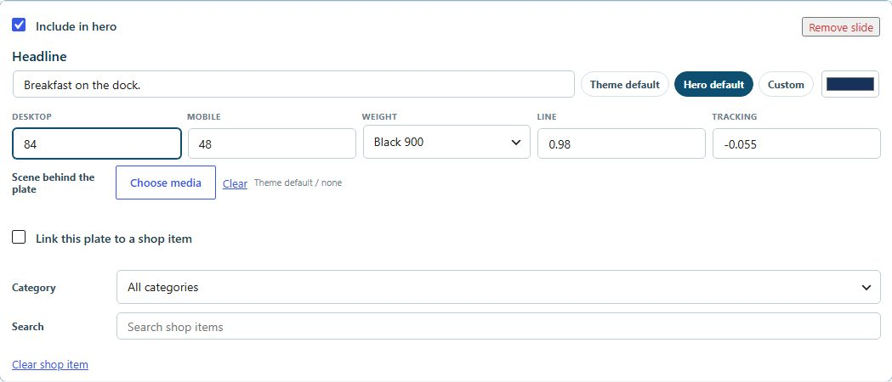</a> <strong>Layer inspector</strong></td>
    <td width="50%" align="center"><a href="docs/previews/admin/hero-studio-timeline.jpg">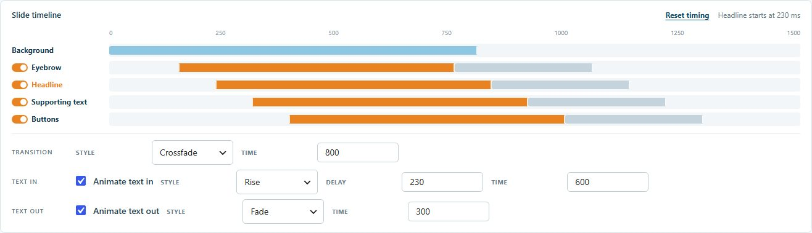</a> <strong>Motion timeline</strong></td>
  </tr>
  <tr>
    <td align="center"><a href="docs/previews/admin/hero-studio-playback.jpg">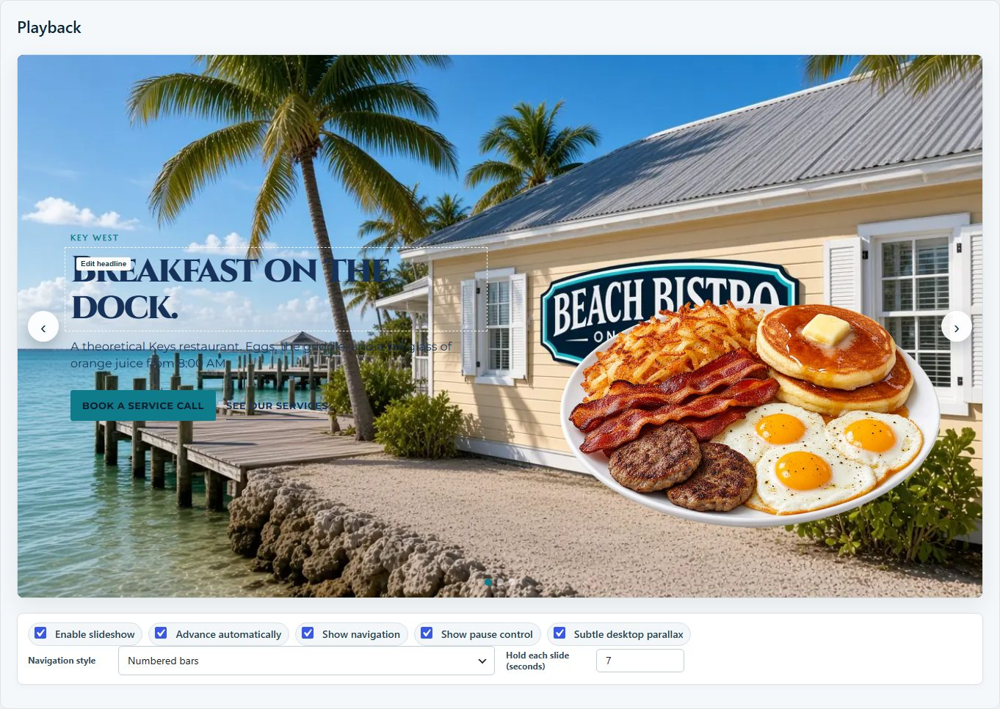</a> <strong>Playback</strong></td>
    <td align="center"><a href="docs/previews/admin/hero-studio-design.jpg">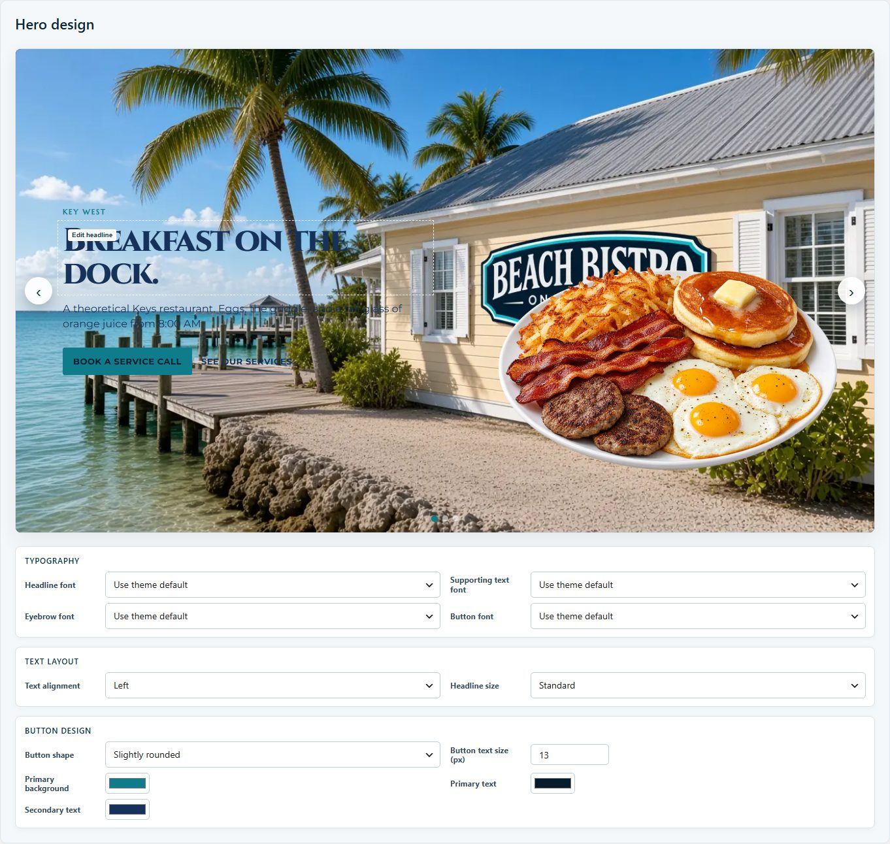</a> <strong>Hero design</strong></td>
  </tr>
</table>

<small>Captured from the local WordPress Admin on November 1, 2026.</small>

| Design area | Controls available now |
| --- | --- |
| **Slides and media** | Add, remove, enable, and select slides. Use a still image or muted MP4/WebM video; the image serves as the video poster and fallback. A scene can sit behind the plate. |
| **Copy and actions** | Edit the eyebrow, headline, supporting text, and two buttons for each slide. Set each button's label and destination; choose button shape, size, font, and colors in the shared hero design controls. |
| **Type and color** | Inherit the site's fonts, use a hero font, or choose a slide font. Adjust headline scale for desktop and mobile, weight, line height, letter spacing, and text color. Set the hero's text alignment. |
| **Overlays** | Choose gradient, even tint, vignette, or no overlay. Set overlay color and opacity to keep text readable over different imagery. |
| **Transitions** | Crossfade, lateral slide, rise, soft zoom, curtain reveal, or instant, with a 300–2000 ms transition duration. |
| **Layer animation** | Give the background and text layers their own entry and exit styles, start times, and durations. Drag timeline bars or enter values; reset the stagger when needed. |
| **Playback** | Run a slideshow or one static image or video. Set a 4–12 second slide hold, autoplay, numbered bars/dots/arrows, a pause control, and subtle desktop parallax. |
| **Preview and publish** | Review unsaved changes on desktop, mobile, or in a full-screen modal; save when the composition is ready. |

The first slide is server-rendered in HTML, so the headline and initial visual remain available before JavaScript runs. Reduced-motion preferences suppress decorative motion and automatic playback. The live editor is part of this theme; an Elementor-built homepage manages its own hero separately.

The table above describes the controls included in **v0.1.0**.

## Theme options

<a href="docs/previews/admin/customizer-overview.jpg">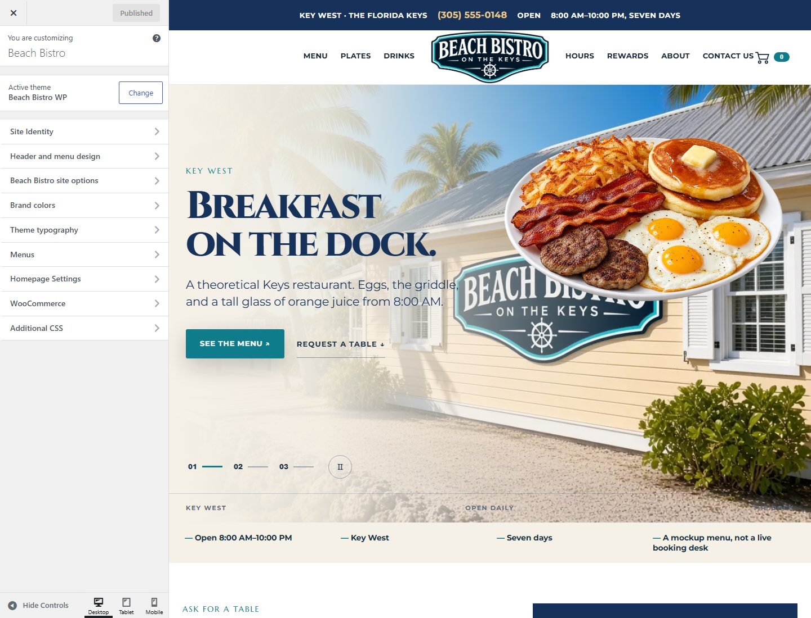</a>

<small>Beach Bistro settings in the local WordPress Customizer, captured November 1, 2026. The homepage cache switch is in site options.</small>

<table>
  <tr>
    <td width="25%" align="center"><a href="docs/previews/admin/customizer-header.jpg">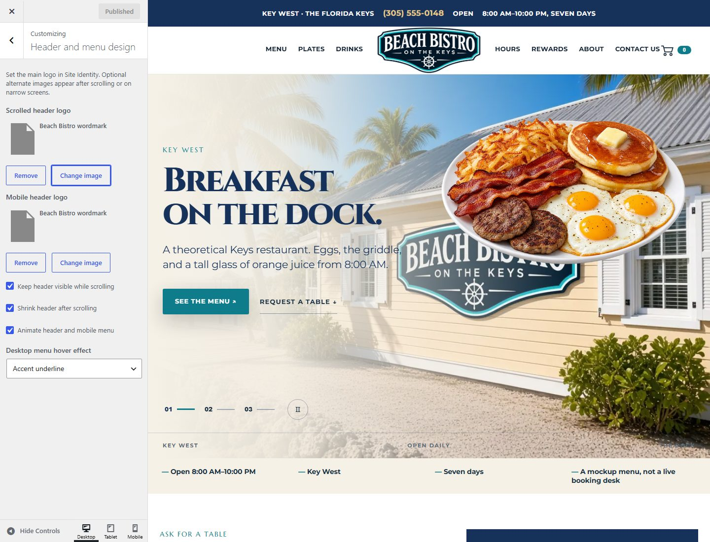</a> <strong>Header and menu</strong></td>
    <td width="25%" align="center"><a href="docs/previews/admin/customizer-colors.jpg">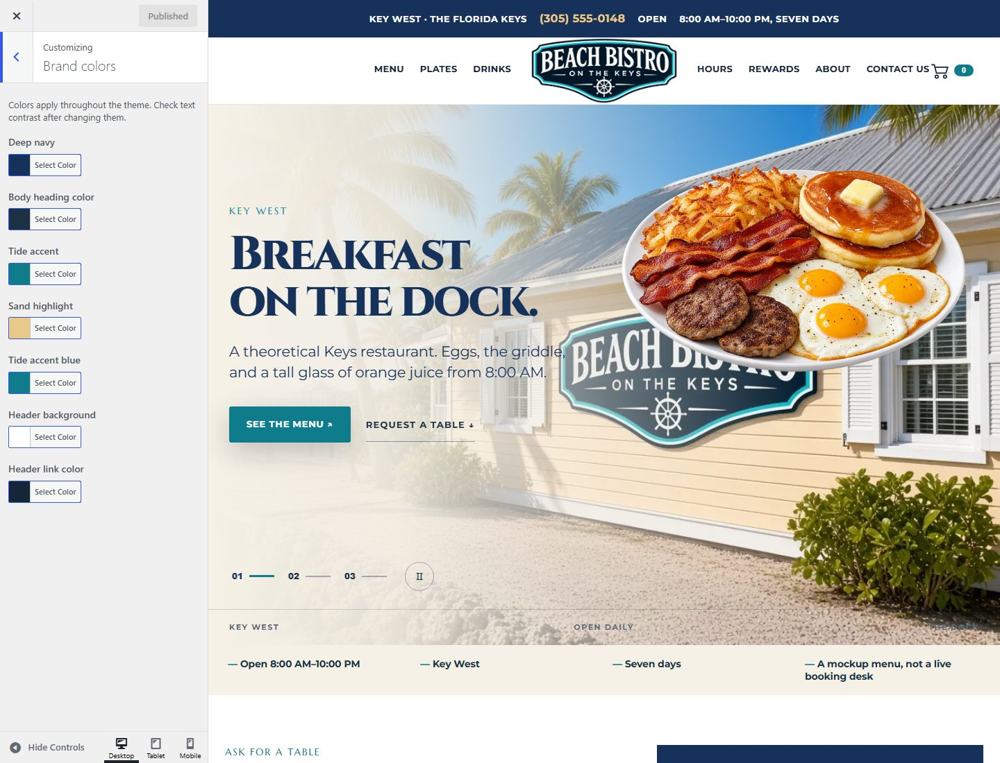</a> <strong>Brand colors</strong></td>
    <td width="25%" align="center"> <strong>Typography</strong></td>
    <td width="25%" align="center"><a href="docs/previews/admin/customizer-site-options.jpg">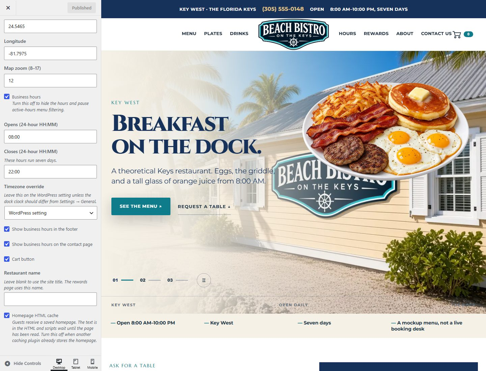</a> <strong>Site options</strong></td>
  </tr>
</table>

| Area | Settings |
| --- | --- |
| Presentation | One scrolling page or a multi-page site with About Us and Contact Us |
| Typography | Site body, heading, and navigation fonts, including selected Google Fonts |
| Brand colors | Navy, tide, sand, cream, and header colors |
| Header and menu | Main, scrolled, and mobile logos; sticky header, scroll shrink, and menu transitions |
| Contact | Form recipient and preview mode until a recipient is configured |
| Map | Keyless OpenStreetMap on Contact Us or above every page footer |
| Hours | Seven-day open and close, a timezone override, footer and contact display, and dated holidays |
| Homepage cache | Saved guest homepage. Text stays in the HTML and scripts wait. Turn it off when another cache plugin stores the page |

The Key West map point is an example. The theme includes [OpenStreetMap attribution](https://www.openstreetmap.org/copyright). The contact form sends through WordPress mail and does not store submissions in the site database; delivery depends on the host's mail setup. The homepage request stays in preview until a recipient email is set.

<a href="docs/previews/admin/dock-hours.jpg">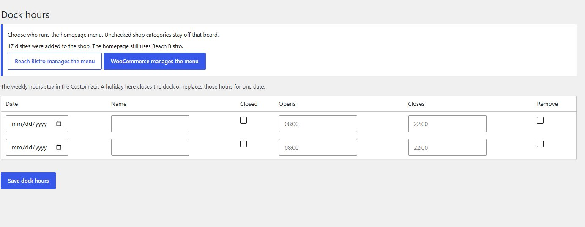</a>

<small>Appearance → Dock hours. Holidays can close the day or replace the open and close times.</small>

## Menu and WooCommerce

The menu plugin keeps the board in WordPress. Dishes, a spreadsheet, kitchen windows, and the source switch are the controls. Beach Bistro can run the homepage menu on its own, or WooCommerce can run it from the checked shop categories. WooCommerce is optional. Gift cards and loyalty offers stay off the menu categories.

<table>
  <tr>
    <td width="50%" align="center"><a href="docs/previews/admin/menu-dishes.jpg">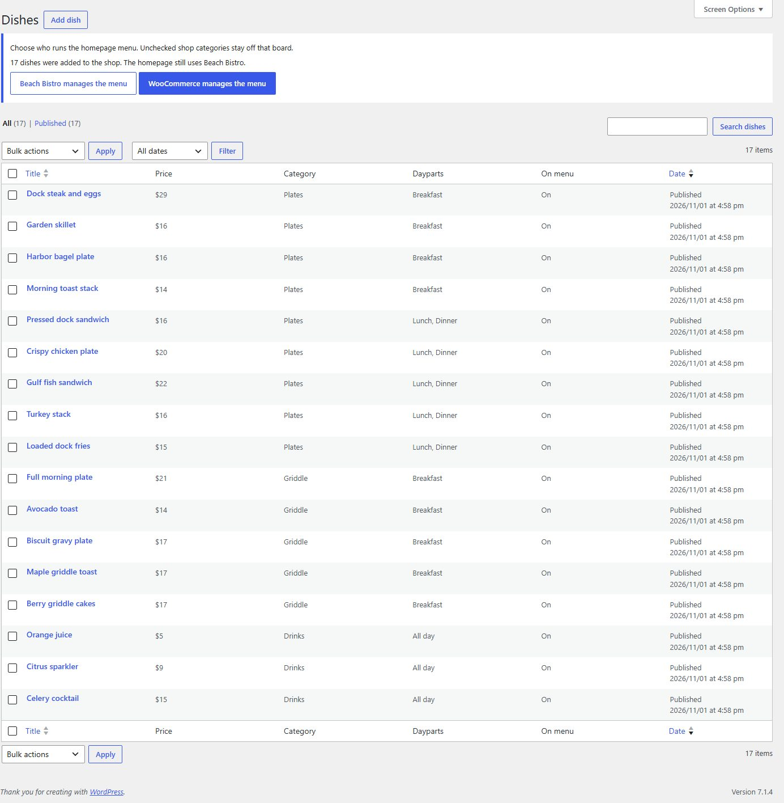</a> <strong>Dishes</strong></td>
    <td width="50%" align="center"><a href="docs/previews/admin/menu-source.jpg">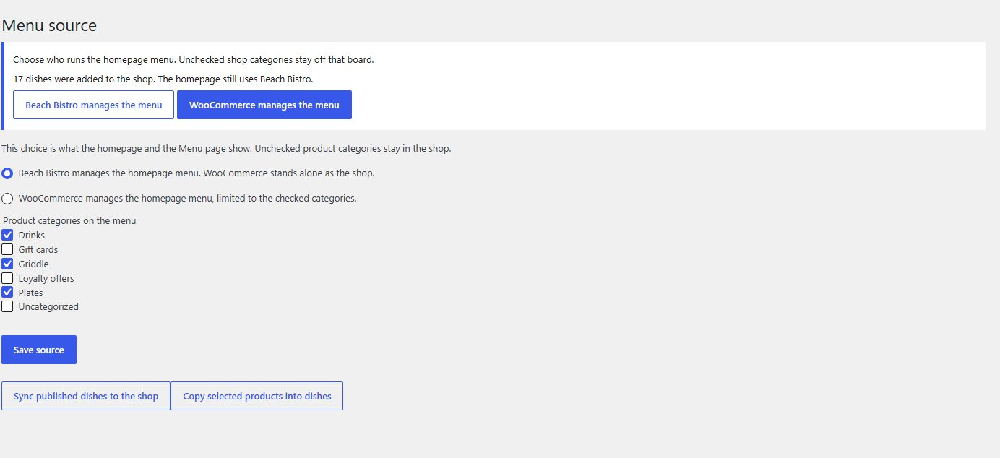</a> <strong>Source</strong></td>
  </tr>
  <tr>
    <td align="center"><a href="docs/previews/admin/menu-kitchen.jpg">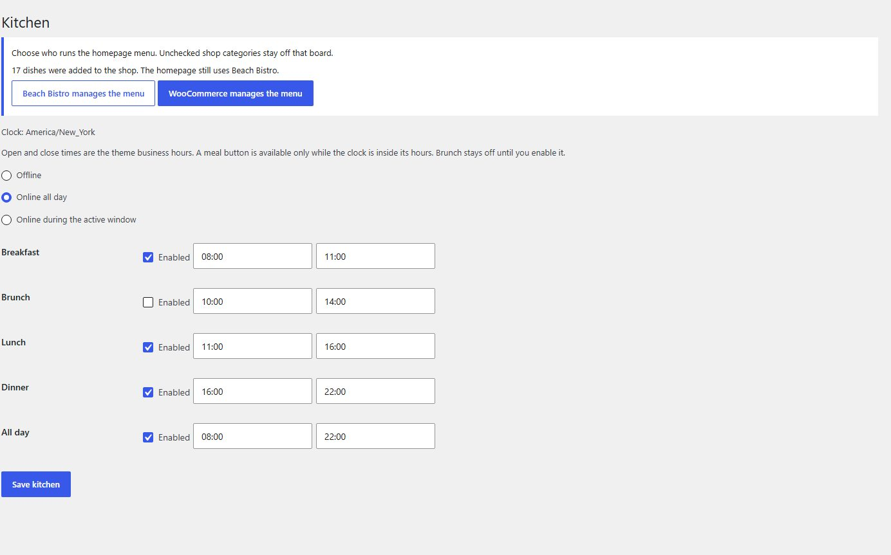</a> <strong>Kitchen</strong></td>
    <td align="center"><a href="docs/previews/admin/menu-spreadsheet.jpg">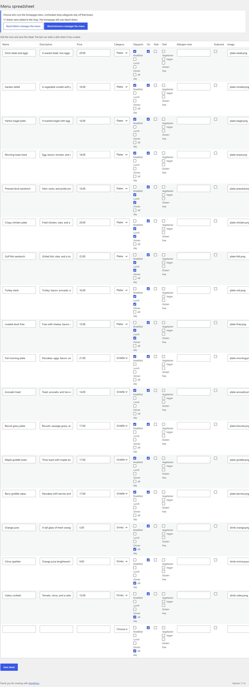</a> <strong>Spreadsheet</strong></td>
  </tr>
</table>

<small>Bistro menu in the local WordPress lab. The homepage stays on the Beach Bistro source.</small>

## Reservations

The reservation form is a month grid and a set of open times. Dine-in, pickup, and takeout are the saved services. The form stays in preview until a recipient email is set. OpenTable replaces this form only when a restaurant id is saved.

<a href="docs/previews/admin/reservations.jpg">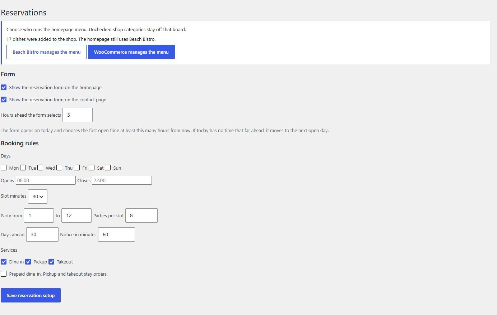</a>

<small>Contact Us after the month grid fix, and Reservations in the local WordPress lab.</small>

## Build and compatibility

<table>
  <tr>
    <td align="center" width="33%"> <strong>WordPress 6.4+</strong> Theme templates and settings</td>
    <td align="center" width="33%"> <strong>PHP 7.4+</strong> Server-rendered homepage</td>
    <td align="center" width="33%"> <strong>JavaScript</strong> Hero Studio, playback, filters, and the tide band</td>
  </tr>
  <tr>
    <td align="center"> <strong>HTML5</strong> Page structure, with a saved guest homepage</td>
    <td align="center"> <strong>CSS3</strong> Responsive layout, inlined on the homepage</td>
    <td align="center">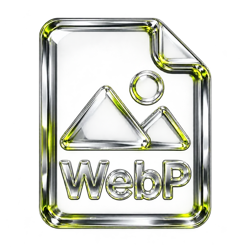 <strong>WebP</strong> The front uses the WebP sibling when it exists</td>
  </tr>
</table>

The starter layouts run with WordPress core. Free Elementor is optional for a separately built homepage. Menu, reservations, loyalty, OpenTable, and Popmenu are optional plugins and stay off until they are configured. WooCommerce is optional for a shop, gift cards, and reward accounts. Below-the-fold photos load lazily; the first hero image loads eagerly. Theme asset URLs use file-specific cache versions so editor CSS and JavaScript update together.

The tide band tracks the scroll. Reduced motion skips that effect. Homepage speed is automatic. Layout CSS is in the HTML, scripts wait until the page has been read, and guests can receive a saved copy of that page. The switch is **Homepage HTML cache** under Beach Bistro site options. Turn it off when another cache plugin already stores the homepage.

**Lab check, November 1, 2026:** Version 0.1.0 was measured on a hosted WordPress 7.1.4 test install running Namecheap’s smallest shared plan, on a subdomain. Cloudflare and a CDN were not used. Performance depends on the host. Lighthouse 12.8.2 scored Performance 74, Accessibility 88, Best Practices 100, and SEO 61 on mobile (simulated Slow 4G), and Performance 92, Accessibility 88, Best Practices 100, and SEO 61 on desktop. Mobile LCP was 6.5 s; desktop LCP was 1.5 s. SEO is held down by the lab `noindex` flag and a missing meta description. The lab URL remains internal. [Score cards](performance/2026-11-01/README.md).

## Availability

This public repository contains a case study and dated lab captures. The installable WordPress theme and PHP source stay in a separate private repository. Contact [Joseph Edwards](https://github.com/RawPowered) for access and terms.

The food photographs are theme art with WebP siblings. The previews contain no production database, credentials, submissions, or client uploads. Contact actions in the lab do not book a real table.
