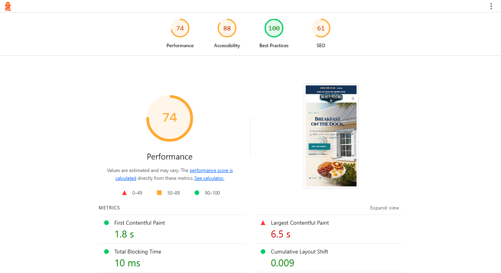
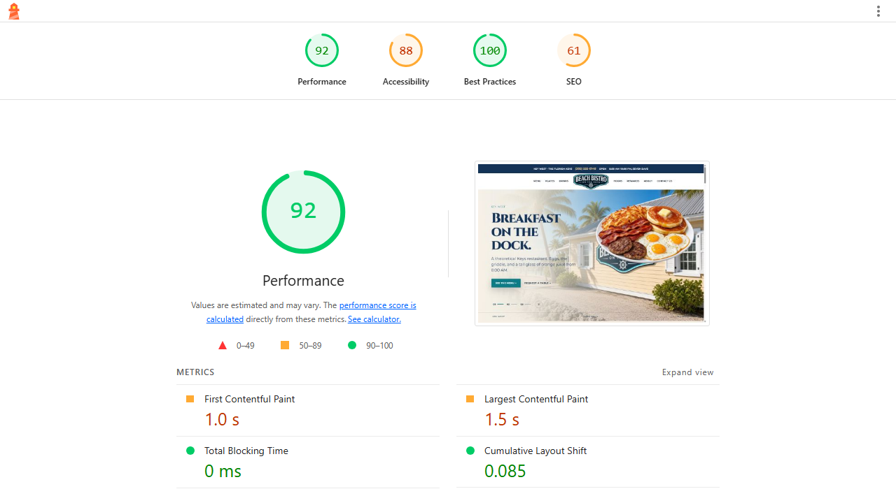

# Hosted WordPress performance check

**Captured November 1, 2026, about 7:20 PM CDT.** Beach Bistro WordPress 0.1.0 was measured on a hosted WordPress test installation. The host was Namecheap’s smallest shared plan, on a subdomain. Cloudflare and a CDN were not used. Performance depends on the host. The internal test address is omitted from this public record. These screenshots are the Lighthouse score view from that run.

| Lighthouse profile | Performance | Accessibility | Best Practices | SEO | FCP | LCP | TBT | CLS |
| --- | ---: | ---: | ---: | ---: | ---: | ---: | ---: | ---: |
| Mobile | 74 | 88 | 100 | 61 | 1.8 s | 6.5 s | 10 ms | 0.009 |
| Desktop | 92 | 88 | 100 | 61 | 1.0 s | 1.5 s | 0 ms | 0.085 |

The reports used Lighthouse 12.8.2 and Headless Chromium. Mobile used an emulated phone with simulated Slow 4G. These are anonymous initial page-load lab runs of the homepage. Homepage speed is automatic: the theme serves WebP art, inlines the layout CSS, and defers scripts. Guests can receive a saved copy of that homepage. The switch is Homepage HTML cache.

The test site includes `noindex, nofollow`, and the homepage has no meta description. Those two SEO audits account for the 61 score. The indexing block should be removed when a production site is ready for search. Lab scores do not represent field Core Web Vitals, concurrency, or uptime. A single pass can move, especially the mobile largest paint, because the plate images are still larger than the space they occupy on a phone.
